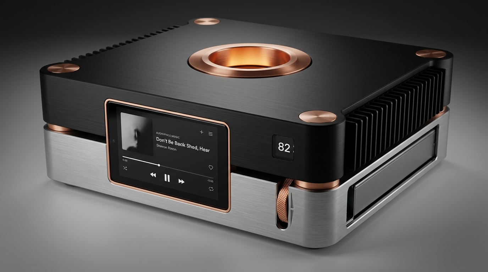
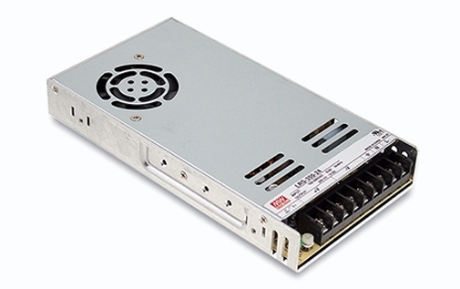
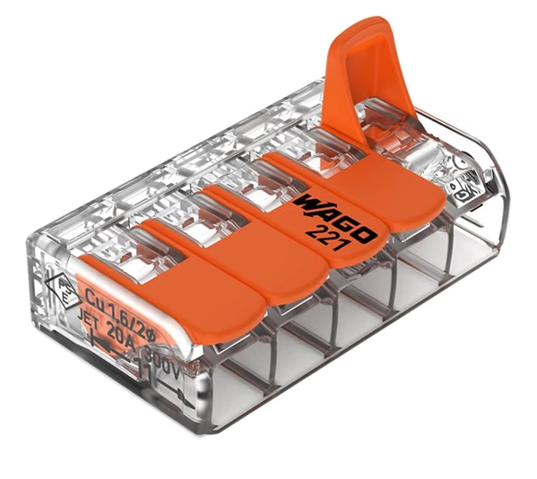
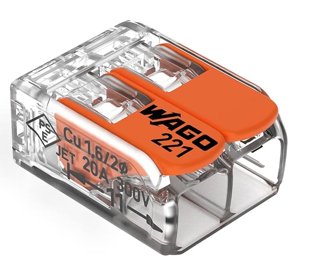
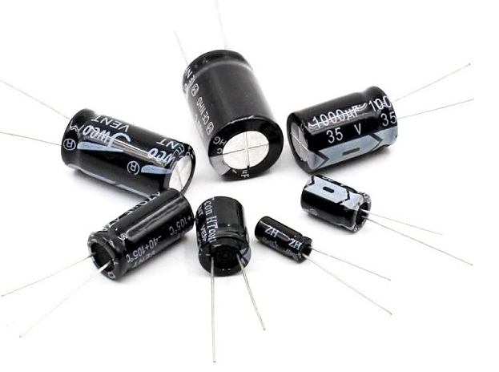
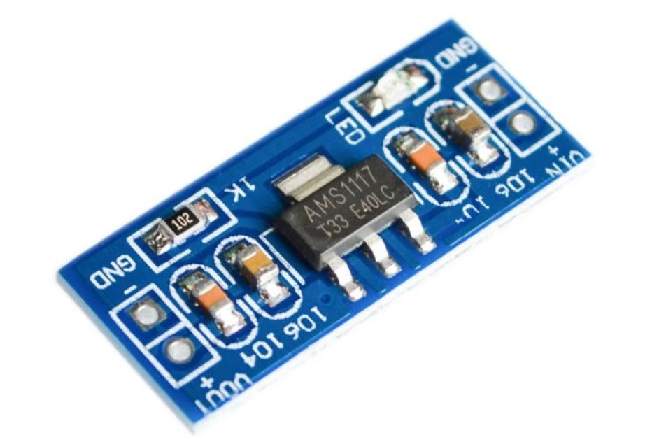
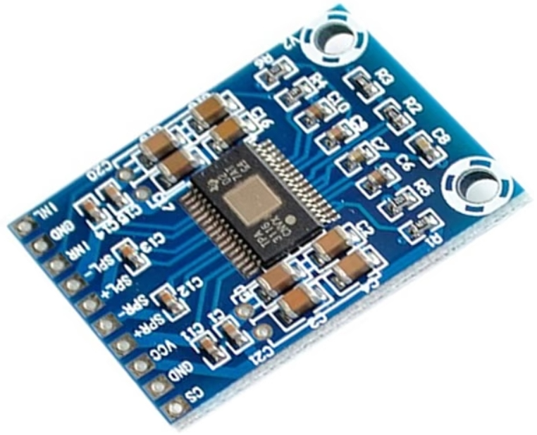
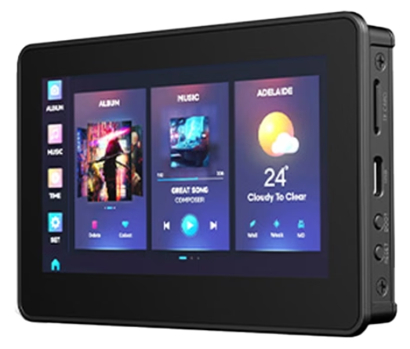
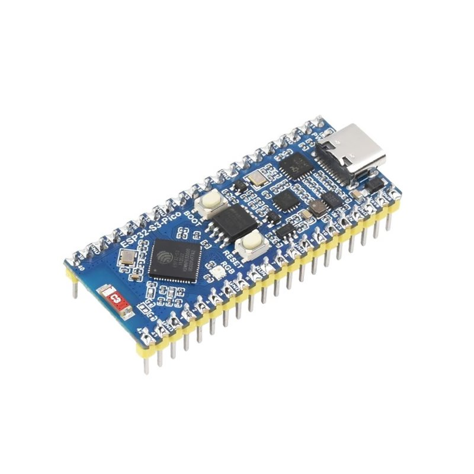
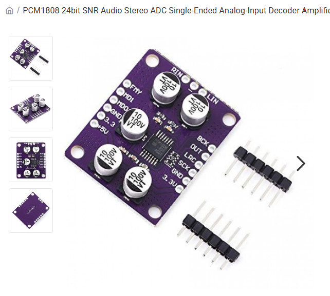

# DIY 5.1 Analog Amplifier — Copper Chimney V2

> **DOCUMENT STATUS: MASTER SPECIFICATION & SINGLE SOURCE OF TRUTH (SSOT)**  
> **Build Location:** Pimpri / Chakan prototype  
> **Target Cost:** Rs 12,400 – 13,500  
> **Status:** Design locked — sourcing & bench prep phase  
> **Last Updated:** 2026-10-12  
> **Master Revision:** 2.1 (Full 100% PSU load, Soldered header pins, MCP4251 omitted, Verified stock)  

---

## 1. Project Overview

A compact, fanless, premium **5.1 home-theater amplifier** built in a 160mm aluminum cube.

- **Pure analog signal path** — no DSP coloration on audio
- **ESP32 control only** — volume, EQ, presets, Bluetooth source
- **Hybrid reliable wiring** — Soldered header pins on all dev boards/DACs/ADC/buck for vibration-proof reliability + WAGO 221 lever nuts for 24V power bus + JST-XH crimp disconnects for signal paths
- **Natural convection cooling** — copper chimney + aluminum fins, zero fan noise
- **Polycarbonate architecture** — 360° RF-transparent panels (Top, Back, Bottom, Front), shatterproof, internal copper chimney visible
- **Carrier Motherboard Layout & Circuit Schematic:** [Open Motherboard Layout (CARRIER_MOTHERBOARD_DIAGRAM.html)](file:///d:/Documents/DIY%20Amp/CARRIER_MOTHERBOARD_DIAGRAM.html) & [Vector Screenshot (carrier_motherboard_diagram.png)](file:///d:/Documents/DIY%20Amp/image/carrier_motherboard_diagram.png)
- **Simplified Application Diagram:** [Open Interactive Application Diagram (SIMPLIFIED_APPLICATION_DIAGRAM_V3_FINAL.html)](file:///d:/Documents/DIY%20Amp/SIMPLIFIED_APPLICATION_DIAGRAM_V3_FINAL.html)
- **Interactive 3D Turntable Studio:** [Open 360° Chassis Viewer & GIF Studio (CHASSIS_360_VIEWER.html)](file:///d:/Documents/DIY%20Amp/CHASSIS_360_VIEWER.html)
- **Quality & Reliability Engineering:** [Open Quality Dashboard (QUALITY_MANAGEMENT_FMEA_CP.html)](file:///d:/Documents/DIY%20Amp/QUALITY_MANAGEMENT_FMEA_CP.html) & [Quality Manual (QUALITY_MANAGEMENT_FMEA_CP.md)](file:///d:/Documents/DIY%20Amp/QUALITY_MANAGEMENT_FMEA_CP.md) (AIAG-VDA DFMEA, PFMEA, Control Plan)
- **Shop Floor Assembly Workbench:** [Open Assembly Workbench (ASSEMBLY_MANUAL.html)](file:///d:/Documents/DIY%20Amp/ASSEMBLY_MANUAL.html) & [Assembly SOP (ASSEMBLY_GUIDE.md)](file:///d:/Documents/DIY%20Amp/ASSEMBLY_GUIDE.md) (10 Phases, 20 Steps, Torque Matrix)

---

## 2. System Architecture

```
Audio Sources:
    ├── 3.5mm Stereo AUX Jack (CentIoT PJ392A-1) → PCM1808 Stereo ADC (24-bit 96kHz I2S)
    └── Bluetooth 5.0 LE / A2DP Sink (ESP32-S3 internal RF transceiver)

Digital Audio Brain & Wireless/Touch HMI (Dual-MCU Clean Left-to-Right Architecture):
    ├── Controller 1 (Touch HMI / Wireless Remote): Waveshare ESP32-S3 4.3B Touch LCD (Model 28141, 800×480 IPS)
    │       ├── Dedicated LVGL Touch UI (Master Volume, Dialogue Boost, Sub Gain, Surround Delay 5–25ms, Flowing Cymbal Mode)
    │       └── Links to Audio Master via Wireless ESP-NOW (<2ms latency, Battery Sofa Remote Mode)
    ├── Controller 2 (MASTER Audio & Clock Engine): Waveshare ESP32-S3-Pico (SKU: 1552780, 16MB Flash, 2MB PSRAM)
    │       ├── I2S Master Clocks (BCK GPIO 15, LRCK GPIO 16, MCLK GPIO 2 to PCM1808 SCKI)
    │       ├── 32-Bit Float Active Matrix Decoding (Dolby Pro Logic II emulation)
    │       │     ├── Front Left = L - (0.5 × C) & Front Right = R - (0.5 × C) → DOUT1 (GPIO 7) → DAC #1 → Amp #1 (Queena)
    │       │     ├── Center Voice = 0.707 × (L + R) + 2.5kHz vocal boost → DOUT2 Left (GPIO 6) → DAC #2 → Amp #2 L (Toyotone)
    │       │     └── Subwoofer = Linkwitz-Riley 24dB/oct <80Hz (L + R) → DOUT2 Right (GPIO 6) → DAC #2 → Amp #2 R (Fredo 8Ω)
    │       ├── DIN (GPIO 4) ← PCM1808 Stereo ADC (24-bit 96kHz line-in from switched AUX / VHM-314 BT)
    │       └── UART TX (Settings link) → Synchronizes master volume, mute, and delay to Slave MCU
    └── Controller 3 (SLAVE Surround & Flowing Cymbal Engine): ESP32-WROOM-32 (30-Pin Dev Board)
            ├── I2S Slave Receiver (D26 BCK in, D25 LRCK in, D35 DIN in tapped from PCM1808 OUT)
            ├── Surround Extraction: Surr_L = Delay_15ms(L - R) & Surr_R = Delay_15ms(R - L)
            ├── Flowing Cymbal Shimmer Synth: Roland TR-808 inharmonic ratios + 0.25Hz stereo swell (optional ambient mode)
            └── DOUT (D27) → PCM5102A DAC #3 → Amp #3 (2×50W) → Silver Dome + Piezo (||) Surrounds
        (NE5532 analog filter boards and MCP4251 digital pots OMITTED — 100% digital domain audio)

Amplification (Direct Analog Infeed):
    3x PCM5102A DAC Line-Outs → 3x XH-M562 TPA3116D2 Stereo Class-D Boards (2x50W @ 24V 4Ω)
        └── 6x BTL Discrete Speaker Outputs (FL, FR, RL, RR, Center, Sub)
            └── 12x JS-910B Binding Posts mounted in non-conductive Polycarbonate rear panel

Power:
    Mains 230V AC → Mean Well LRS-350-24 (24V, 14.6A, 350W) [External Wall-Mounted]
        └── Umbilical (16 AWG Pair) via GX16 4-Pin Aviation Plug (2 Pins Parallel per Rail)
            ├── Mandatory Cold-Plug Protocol (Mean Well Soft-Start Ramped Inrush)
            ├── 2x WAGO 221-415 Distribution Blocks (+24V & GND Rails)
            ├── 4700µF 50V Low-ESR Electrolytic Reservoir Capacitor
            ├── 3x XH-M562 TPA3116D2 Boards (Direct 24V Rails)
            └── XL4015 Buck Converter (24V → 5.00V ± 0.05V for ESP32 + DACs + ADC)
```

### 5.1 Channel & 8-Output Speaker Array Assignment (ESP32 Volume & Frequency Controlled)

| Board | Ch A | Ch B | Configured Power | Notes |
| :--- | :--- | :--- | :--- | :--- |
| **Amp #1 (`TPA3116D2 #1`)** | **Ch 1:** Front Left (`FL`) — `30W` | **Ch 2:** Front Right (`FR`) — `30W` | **`60W` (`30W × 2`)** | Main stereo wall (`9 ft`) + floor (`18 ft`) array |
| **Amp #2 (`TPA3116D2 #2`)** | **Ch 3:** Subwoofer (`Sub`) — `30W` | **Ch 4:** Midrange (`20W`) + 4" Center Voice (`10W`) | **`60W` (`30W + 30W`)** | Summed mono sub (`< 100 Hz`) + full-range mid & voice |
| **Amp #3 (`TPA3116D2 #3`)** | **Ch 5:** Surround L/R (`10W × 2`) | **Ch 6:** Piezo Sparkle (`10W × 2`) | **`40W` (`20W + 20W`)** | Dual-mode Surround / Cymbal + Piezo super-tweeter array |

#### Master 8-Output Rear Binding Post Mapping (`16× JS-910B Binding Posts`)

| S.no | Rear Binding Post Pair | Connected Speaker 1 | Connected Speaker 2 | Internal Amp Source | ESP32 Digital Power Cap & Frequency Filter |
| :---: | :--- | :--- | :--- | :--- | :--- |
| **1** | **Output #1 (`FL`)** | 4" Queena in Porcelain *(Left Wall, above listener, `9 ft` from screen)* | 4" Queena in Mud Pot *(Left bottom floor, `18 ft` from screen)* | **Amp #1 — Ch 1** | **`30W` (`> 100 Hz`)** — Independent Vol & Freq Control |
| **2** | **Output #2 (`FR`)** | 4" Queena in Porcelain *(Right Wall, above listener, `9 ft` from screen)* | 4" Queena in Porcelain *(Right bottom floor, `18 ft` from screen)* | **Amp #1 — Ch 2** | **`30W` (`> 100 Hz`)** — Independent Vol & Freq Control |
| **3** | **Output #3 (`SL / Cymbal L`)** | Silver Dome Tweeter #1 *(or Surround L)* | — | **Amp #3 — Ch 5** *(Surround 1)* | **`10W`** Volume-Boosted Cymbal / Surround (ESP32 Vol & Freq Control) |
| **4** | **Output #4 (`SR / Cymbal R`)** | Silver Dome Tweeter #2 *(or Surround R)* | — | **Amp #3 — Ch 5** *(Surround 2)* | **`10W`** Volume-Boosted Cymbal / Surround (ESP32 Vol & Freq Control) |
| **5** | **Output #5 (`Center Voice`)** | 4" Queena in Porcelain *(Above Screen, `0 ft`)* | — | **Amp #2 — Ch 4** *(Branch A)* | **`10W Max`** (ESP32 Software Cap + `47µF` Cap, Pure Voice) |
| **6** | **Output #6 (`Sub-Bass`)** | 8" Sub-Bass Woofer | — | **Amp #2 — Ch 3** | **`30W` Sub-Bass (`< 100 Hz`)** — Independent Vol & Freq Control |
| **7** | **Output #7 (`Full-Range Mono`)** | 8" Full-Range + `45°` Porcelain Reflector *(Under Bench, `18 ft`)* | — | **Amp #2 — Ch 4** *(Branch B)* | **`20W` Direct Midrange / Full-Range Power** (ESP32 Vol & Freq Control) |
| **8** | **Output #8 (`Piezo Sparkle`)** | Piezo Super-Tweeter Array (`2× Piezos`) | — | **Amp #3 — Ch 6** | **`10W × 2` (`20W`) High-Frequency Sparkle (`> 10 kHz`)** — Independent Vol & Freq Control |

---

## 3. Mechanical Specification (Compact Modular Architecture)

> **Full Mechanical CAD Blueprint & Standard Fastener BOM (`M-01` to `M-26`):** [Open Interactive Amp Design Drawing & Bolt/Nut BOM (AMP_DESIGN_DRAWING.html)](file:///d:/Documents/DIY%20Amp/AMP_DESIGN_DRAWING.html) • [Markdown Blueprint (AMP_DESIGN_DRAWING.md)](file:///d:/Documents/DIY%20Amp/AMP_DESIGN_DRAWING.md) • [Machine-Readable TSV (AMP_MECHANICAL_BOM.tsv)](file:///d:/Documents/DIY%20Amp/AMP_MECHANICAL_BOM.tsv)



### Enclosure & 6-Face Layout (`160 × 160 × 95 mm` Compact Amplifier Module + Modular SMPS Base)

| Face | Material / Component | Features & Purpose |
| :--- | :--- | :--- |
| **Front** | 4mm Polycarbonate + 3-Slot Click-In Dock | **Click-In Touch Dock:** Waveshare 4.3B Touch LCD (`Model 28141`) clicks into the front cradle (auto-charges via magnetic USB-C/pogo pins) and pops out as a handheld **Wireless ESP-NOW/Wi-Fi Battery Sofa Remote** |
| **Front-Right Edge** | Recessed `15 mm` Sideways Volume Wheel | Standard knurled knob mounted sideways in a `15 mm` vertical slot with a **painted/reflective tapered `V`-line (`0 to 15 mm` fill gauge)** for instant visual volume check |
| **Rear** | 4–5mm Polycarbonate Machined Panel | **Electric & Audio I/O:** GX16 4-Pin 24V power inlet (2 pins parallel per rail), **16× JS-910B binding posts (8 output pairs)**, 3.5mm AUX, USB-C. **Non-conductive** (eliminates BTL short circuit risk!) |
| **Left & Right** | AL6061 Black Finned Heatsink Plates | **Cooling Fins (Sides 1 & 2):** Extruded/machined finned aluminum side walls — primary heatsink for the 3× TPA3116D2 amps |
| **Bottom** | 4–5mm Polycarbonate Baseplate + `15 mm` Feet | Unobstructed bottom cold-air intake aligned with the 35mm central copper chimney; sits above an **Open-Sided 18mm Wooden Shelf** (or standalone on table) so Mean Well SMPS heat never enters the chimney |
| **Top** | 4mm Matte-Black Polycarbonate / Acrylic | **100% Flush Top Deck:** Central 35mm copper chimney ring (standard 1.5" flare/eyelet collar) and 4× 15mm corner copper end-caps sit completely **flush** with the top surface |

### Thermal & Convective Airflow System

| Component | Specification | Function |
| :--- | :--- | :--- |
| **Central Copper Chimney** | 35 mm OD, 148 mm H, hollow open through-and-through | Main convective stack; draws cool air from bottom intake and exhausts hot air out top via natural thermal siphon |
| **Corner Frame (Base Spec)** | 4× Copper Pillars (12 mm OD, 148 mm H, M4 threaded) | Corner structural tie + thermal spreading to top/bottom |
| **Corner Frame (Upgrade Option — Budget Permitting)** | 4× Hollow Copper Tubes (15 mm OD / 1/2" ID) open through-and-through | 3D Copper tube frame: all 4 corner tubes + center tube open through-and-through, creating a 5-channel vertical convective breathing matrix |
| **External Aluminum Fins** | 10 fins/side × 2 sides (2 mm thick, 12 mm deep) | Primary radiant/conductive heat rejection to room |
| **Electronics Chamber Sealing** | Gasketed around copper tubes | The electronics compartment can remain dust-sealed, while the interiors of the copper tubes remain open through-and-through for continuous convective cooling |

### RF & Wi-Fi Transmission Advantage
* **4 RF-Transparent Faces:** With Top, Back, Bottom, and Front constructed from **Polycarbonate (dielectric constant $\epsilon_r \approx 2.9$)**, 2.4 GHz Wi-Fi and Bluetooth signals radiate freely in nearly 360 degrees without Faraday cage attenuation.
* Only Left & Right faces remain Aluminum (functioning as dedicated heatsinks).

### Vendor Brief (Box Maker)

```
160 × 160 × 160 mm hybrid enclosure
Left & Right side plates: AL6061 aluminum, 5 mm wall with 10 cooling fins (2 mm thick, 12 mm deep)
Front panel: 4 mm Polycarbonate (frosted/tinted) with cutout for Waveshare 4.3"/5" Touch LCD
Rear panel: 4–5 mm Polycarbonate with cutouts for GX16 4-Pin (16mm), 12x Binding Posts (8mm), 3.5mm AUX (6mm), USB-C (oval)
Bottom plate: 4–5 mm Polycarbonate with intake slots for 35mm central tube + 4x 15mm corner tubes + feet mounts
Top plate: 4 mm Polycarbonate (clear/frosted) with 35mm chimney + corner tube exhaust pass-throughs
Central chimney: 35 mm diameter copper pipe, center, open through-and-through
Corner frame: 4x 15 mm copper tube pass-throughs, open through-and-through
Mechanical only — no electronics
```

---

## 4. Bill of Materials

> **Total Electronics BOM:** Rs 12,919 (Rs 12,319 in hand/ordered, Rs 600 pending)  
> **Total with Mechanical:** Rs 17,258 (Rs 12,460 in hand/ordered, Rs 4,798 to buy)

### 4.1 Power — 24V Bus

| Item                                           | Specification                           | Qty | Rate (Rs) | Total (Rs) | Vendor                                                                         | Spec Sheet                                                                                                     | Image                                             | Remarks               | Stock status |
| ---------------------------------------------- | --------------------------------------- | --- | --------- | ---------- | ------------------------------------------------------------------------------ | -------------------------------------------------------------------------------------------------------------- | ------------------------------------------------- | --------------------- | ------------ |
| Mean Well LRS-350-24<br>(SMPS) - Single Output | 24V 14.6A 350.4W Switching Power Supply | 1   | 2499      | 2499       | [Hubtrinics,in](https://hubtronics.in/lrs-350-24)                              | [Mean Well LRS-350 Data Sheet](file:///d:/Documents/DIY%20Amp/Mean%20Well%20LRS-350.pdf)                      |      | Available             | 1            |
| Wago 221-415                                   | 5-way lever nut — 24V + GND rails       | 4   | 99        | 396        | [robu.in](https://robu.in/product/wago-221-415-5-conductor-lever-connector/)   | [Wago 221 Spec](wago 221 specs.md)                                                                             |  | Available             | 4            |
| Wago 221-412                                   | 2-way lever nut — amp feeds             | 6   | 49        | 294        | [robu.in](https://robu.in/product/wago-221-412-lever-wire-splicing-connector/) | [wago 221 412 2way spec](wago 221 412 2way spec.md)                                                            |  | Available             | 6            |
| Bulk Cap                                       | 4700 uF 50V Low ESR Electrolytic        | 2   | 70        | 140        | [robu.in](https://robu.in/product/4700uf-50v-electrolytic-capacitor/)          | [[4700uF capacitor Spec Sheet]](4700uF capacitor Spec Sheet.md)                                                |  | On 24V bus for ripple | 2            |
| AMS1117                                        | 3.3V Power Supply Module                | 1   | 19        | 19         | [robu.in](https://robu.in/product/ams1117-3-3v-power-supply-module/)           | [AMS 117 3.3 V Spec Sheet](file:///d:/Documents/DIY%20Amp/AMS%20117%203.3%20V%20power%20supply%20module.md)   |  | Got with header pins  | 1            |

**Section Total: Rs 3,348**

### 4.2 Amplifiers — 3x Stereo (6ch total)

| Item                                                                        | Specification                           | Qty                                                        | Rate (Rs) | Total (Rs) | Vendor                                                                                                                                                                                                             | Spec Sheet                                             | Image                                                                                                                                     | Stock |
| --------------------------------------------------------------------------- | --------------------------------------- | ---------------------------------------------------------- | --------- | ---------- | ------------------------------------------------------------------------------------------------------------------------------------------------------------------------------------------------------------------ | ------------------------------------------------------ | ----------------------------------------------------------------------------------------------------------------------------------------- | ----- |
| <br>TPA3116D2 50W+50W Dual Channel Mini Digital Amplifier Class D Amplifier | 2x50W @ 24V, 4 ohm, Dual Chanel, No pot | 3 ( got 10 pin header pins and 10 pin Female cables 3sets) | 129       | 387        | [robu.in](https://robu.in/product/xh-m562-tpa3116d2-50w50w-dual-channel-mini-digital-amplifier-class-d-amplifier/)                                                                                                 | [XH-M562 Spec Sheet](XH-M562 TPA3116D2.md)             |                                                                                          | 3     |
| [arctic mx-4 4g thermal paste](arctic mx-4 4g thermal paste.md)             | For TPA3116 chips                       | 1                                                          | 480       | 480        | [mdcomputers.in/product/arctic-mx-4-4g-thermal-paste-actcp00002b?search=arctic+mx-4+4g+thermal+paste](https://mdcomputers.in/product/arctic-mx-4-4g-thermal-paste-actcp00002b?search=arctic+mx-4+4g+thermal+paste) | [Thermal Paste Specs](arctic mx-4 4g thermal paste.md) |  | 0     |

> **Decision:** Changed from 6x mono (Rs 1,800) to 3x stereo (Rs 900) — same 6 channels, saves Rs 900.

**Section Total: Rs 867**

### 4.3 DAC + Brain (Dual-ESP32-S3 Architecture)

| Item                                                                                         | Specification                                     | Qty                                                         | Rate (Rs) | Total (Rs) | Vendor                                                                                                                                                                                                                                         | spec sheet                                                                                                             | image                                                                                                                                                                  | Remarks               | Stock |
| -------------------------------------------------------------------------------------------- | ------------------------------------------------- | ----------------------------------------------------------- | --------- | ---------- | ---------------------------------------------------------------------------------------------------------------------------------------------------------------------------------------------------------------------------------------------- | ---------------------------------------------------------------------------------------------------------------------- | ---------------------------------------------------------------------------------------------------------------------------------------------------------------------- | --------------------- | ----- |
| Waveshare ESP32-S3 4.3B 800×480 5-point Touch LCD Development Board Type B with plastic case | Built-in 16MB Flash and 8MB PSRAM (Model 28141)   | 1                                                           | 5349      | 5349       | [robu.in](https://robu.in/product/waveshare-esp32-s3-4-3b-800x480/)                                                                                                                                                                            | [Waveshare ESP32-S3 Spec](file:///d:/Documents/DIY%20Amp/Waveshare%20ESP32-S3%20with%20Touch%20spec.md)               |                                                                                                                       | Dedicated Touch HMI (Wireless ESP-NOW/Wi-Fi Battery Remote or Docked I2C) | 1     |
| Waveshare ESP32-S3-Pico Microcontroller Development Board with Pin Header (SKU: 1552780)     | 32-bit LX7 Dual-Core @ 240MHz, 16MB Flash, 2MB PSRAM, 512KB SRAM, CH343+CH334 USB-C, Pre-Soldered Headers | 1                                                           | 1209      | 1209       | [robu.in](https://robu.in/)                                                                                                                                                                                                                    | [ESP32-S3-Pico Spec](file:///d:/Documents/DIY%20Amp/esp32.md)                                                          |                                                                                                      | Ordered (SKU: 1552780). Dedicated Internal 6-Ch I2S Audio DSP Engine | Ordered (1) |
| PCM5102A DAC Board                                                                           | Stereo I2S, HW-280                                | 3 ( Got 3 sets of header pins and female pins with cables ) | 449       | 1347       | [hubtronics.in](https://hubtronics.in/pcm5102-i2s-digital-audio-dac-decoder-module?search=06327)                                                                                                                                               | [PCM5102 12S Spec.md](PCM5102 12S Spec.md)                                                                             |  | 3 boards = 6 channels | 3     |
| PCM1808 24bit SNR Audio Stereo ADC                                                           | Single-Ended Analog-Input Decoder Amplifier Board | 1 ( Got with header Pins and female poins with cables)      | 209       | 209        | [hubtronics.in](https://hubtronics.in/pcm1808-dac-module?gad_source=1&gad_campaignid=24029996130&gbraid=0AAAAAD07y2ftf7evhojMR9dNvWgQ7mCrk&gclid=Cj0KCQjw8ofWBhCHARIsANBj4Lu6mPFeOuoDGNgtzuSY_zVwYS7Z8gmrWqhDEI2IZtqsGJcPgI7ayCQaAq5fEALw_wcB) | [PCM1808 Specs](file:///d:/Documents/DIY%20Amp/PCM1808%2024bit%20SNR%20Audio%20Stereo%20ADC%20Single-Ended%20Analog-Input%20Decoder.md) |                                                                                                                       |                       | 1     |
| XL4015 5A DC-DC Buck Step Down Adjustable Power Supply Module                                | 24V → 5.0V, 3A                                    | 1                                                           | 90        | 90         | [robu.in](https://robu.in/product/xl4015-5a-dc-dc-step-down-adjustable-power-supply-buck-module-led-with-heatsink/)                                                                                                                            | [XL4015 Spec.md](XL4015 Spec.md)                                                                                       |                  | For ESP32 + DACs      | 1     |

**Section Total: Rs 8,204**

### 4.4 Wiring / Protection

| Item                             | Specification                       | Qty    | Rate (Rs) | Total (Rs) | Stock                |
| -------------------------------- | ----------------------------------- | ------ | --------- | ---------- | -------------------- |
| DC Wire 16 AWG                   | Red/Black, 24V bus                  | 2 m    | 40        | 80         | Available (In Lab)   |
| Signal Wire                      | Shielded 2-core, DAC to Amp         | 3 m    | 40        | 120        | Pending (To Buy)     |
| Fuse + Holder                    | 10A slow-blow on 24V rail           | 1      | 50        | 50         | Available (Stock: 1) |
| Mains Cable                      | 3-pin with earth to PSU             | 1      | 150       | 150        | Available (Stock: 1) |
| Header Pins & Soldering Supplies | 2.54mm male/female headers + solder | 1 set  | 100       | 100        | Available (In Lab)   |

**Section Total: Rs 500**

### 4.5 Mechanical & Hardware (Estimate)

| Item                                                            | Qty    | Est. Rate (Rs) | Total (Rs) | Stock / Status |
| --------------------------------------------------------------- | ------ | -------------- | ---------- | -------------- |
| AL6061 Finned Enclosure (160mm cube, 5mm wall, 10 fins/side)    | 1      | 2,000          | 2,000      | Pending (Chakan Job Shop) |
| Copper Chimney (OD 35mm, H 148mm)                               | 1      | 400            | 400        | Pending (Bhosari AC Spares) |
| Copper Pillars (OD 12mm / 15mm, H 148mm, M4)                    | 4      | 60             | 240        | Pending (Nana Peth) |
| Polycarbonate Panels Set (4–5mm Top, Back, Bottom, Front)      | 1 set  | 350            | 350        | Pending (Pimpri Plastics) |
| Speaker Terminals (JS-910B 4mm Binding Posts: 6 Sets In Hand + 2 Sets Ordered) | 16 pcs | 29         | 464        | **Available (12 pcs In Hand + 4 Ordered)** |
| Audio Input Jack (CentIoT PJ392A-1 3.5mm Stereo Gold Plated, Pack of 5) | 1 pack (5 pcs) | 160            | 160        | **Available (In Hand: 5 pcs)** |
| AUX 3.5mm Male-to-Male Cable 2m Grey (Robu SKU: 1794441)        | 1 pc   | 299            | 299        | **Ordered (Robu.in)** |
| 24V Power Socket (GX16 4-Pin Metal Aviation Plug Set)          | 1 set  | 81             | 81         | **Available (In Hand: 1 set)** |
| USB-C Service Port (USB 3.1 Type-C Female 24P Breakout + Cable) | 1 set  | 60             | 60         | Available (Stock: 1) |
| M3/M4 Fasteners + Standoffs + EPDM Gasket                       | 1 set  | 300            | 300        | Pending (Local Hardware) |
| JST-XH Connector Kit + Crimp Tool SN-28B                        | 1 set  | 400            | 400        | Pending (To Buy) |

**Section Total: Rs 4,339**

---

## 5. Design Decisions Log

| #   | Decision           | Chosen                                   | Rejected             | Reason                                                                                                                |
| --- | ------------------ | ---------------------------------------- | -------------------- | --------------------------------------------------------------------------------------------------------------------- |
| D1  | Amp topology       | TPA3116D2 Class-D                        | Class-AB             | Efficiency, low heat, fanless possible                                                                                |
| D2  | Amp config         | 3x stereo boards                         | 6x mono boards       | Same 6 channels, saves Rs 900                                                                                         |
| D3  | Power supply       | Mean Well LRS-350-24                     | Sturlite LED driver  | Sturlite causes audible noise; MeanWell has fan ON/OFF                                                                |
| D4  | Power budget       | 100% full capacity (350W peak)           | 70% clamp            | Mean Well LRS-350-24 handles 350W peak headroom without load concerns; average movie load is ~21W completely silent     |
| D5  | Wiring method      | Soldered Header Pins + WAGO / JST-XH     | Loose jumpers        | All module header pins soldered securely to dev boards; WAGO + JST-XH for modular power and signal routing            |
| D6  | Enclosure          | AL6061, 5mm wall                         | Plastic / steel      | Thermal mass + premium look                                                                                           |
| D7  | Cooling            | Copper chimney + fins                    | Active fan           | Silent operation at all times                                                                                         |
| D8  | Transparent Panels | Polycarbonate (Top, Back, Bottom, Front) | Glass                | Polycarbonate is shatterproof, easy to CNC drill/cut, 100% RF/Wi-Fi transparent, and non-conductive for binding posts |
| D9  | DSP                | ESP32 audio firmware                     | Dedicated DSP chip   | Direct I2S stream decoding & bit-perfect digital volume attenuation in software                                       |
| D10 | Volume control     | ESP32 32-bit Float Digital Trim          | MCP4251 digital pots | MCP4251 OMITTED / NOT REQUIRED: Avoids 5V rail clipping and CMOS wiper non-linearity; ESP32 provides bit-perfect 32-bit float logarithmic volume & balance |
| D11 | Audio Input        | 3.5mm Stereo AUX (CentIoT PJ392A-1)      | 6x RCA jacks         | Modern TV/Projector/BT reality; future 5.1 via HDMI ARC/Optical; saves space & ₹250                                   |
| D12 | Power Infeed Inlet | GX16 4-Pin Aviation (2-Pin Parallel)    | GX16 2-Pin / Amass XT60 | Threaded metal vibration-proof collar lock; 16mm round hole simple to drill; dual pins parallel yield 10A–14A continuous / 15A+ peak headroom; already in hand (₹0 extra cost) |
| D13 | Dual-ESP32-S3 Split Architecture | Waveshare 4.3B Touch (Model 28141) + Waveshare ESP32-S3 DevKit (SKU: 1552780) | Single ESP32-S3 driving both 800×480 RGB LCD & 6-Ch I2S | Model 28141 uses 20+ GPIOs and continuous PSRAM DMA for its 16-bit RGB LCD. Splitting UI and Audio onto two ESP32-S3 boards eliminates PSRAM DMA audio crackling, exposes all 40+ pre-soldered header pins for the 3× DACs + 1× ADC, and allows the 4.3B Touch LCD to operate as a **Wireless ESP-NOW/Wi-Fi Battery-Operated Sofa Remote** or Docked I2C HMI |

---

## 6. Power Budget

```
TPA3116D2 efficiency @ 24V, 4 ohm: ~85%
Peak output per stereo board: 2 x 50W = 100W
3 boards peak total output: 300W (Configured Software Cap: 60W + 60W + 40W = 160W)
Input from PSU at 85% efficiency: 160 / 0.85 = 188W (353W theoretical unclipped peak)

Mean Well LRS-350-24 100% Full Load Operation:
    PSU rating: 24V @ 14.6A = 350.4W continuous (350W peak headroom)
    Configured 8-Output Speaker Load: 160W Max (~46% of PSU capacity — SMPS fan stays 100% OFF!)
    Average listening level (75–80 dB): ~6% of max = ~18W output
    Average PSU input: ~21W — completely silent, zero heat buildup
```

---

## 7. Dual-ESP32-S3 Firmware Notes & Unified Pin Assignment

| Feature | Implementation | Notes |
| --- | --- | --- |
| **Controller 1 (HMI / Remote)** | Waveshare ESP32-S3 4.3B Touch LCD (`Model 28141`) | 800×480 IPS 60fps LVGL Touch UI; operates as **Wireless ESP-NOW / Wi-Fi Battery Sofa Remote** (built-in `CS8501` 3.7V LiPo charger + switch) OR Docked 2-wire `I2C` (`GPIO 8/9`) |
| **Controller 2 (Audio DSP Engine)** | Waveshare ESP32-S3 Dev Board (`SKU: 1552780`, Pre-Soldered Headers) | Dedicated 240 MHz dual-core 6-channel I2S audio processor + biquad crossovers (`>100 Hz`, `<100 Hz`, `>10 kHz`) + Bluetooth A2DP sink |
| **6-channel output** | 3× PCM5102A via Multi-Lane I2S bus on `SKU: 1552780` | Shared `BCK` (`GPIO 15`) & `LRCK` (`GPIO 16`), 3 discrete parallel `DOUT` lines (`GPIO 7, 6, 5`) |
| **Stereo AUX Line-In** | 1× PCM1808 24-bit ADC on `SKU: 1552780` | Shares `BCK` (`GPIO 15`) & `LRCK` (`GPIO 16`), `DOUT` → `GPIO 4` (`DIN`), `SCK/MCLK` ← `GPIO 0` |
| **Per-channel volume & caps** | 32-bit float software trim + biquad filters | Enforces exact speaker caps (`30W` FL/FR, `30W` Sub, `20W` Mid, `10W` Voice, `10W×2` Surround, `10W×2` Piezo) |
| **Presets & Fail-Safe** | Stored in NVS flash on Audio Engine (`SKU: 1552780`) | Amplifier retains last volume/EQ preset and continues playing seamlessly even if wireless touch remote is turned off |

### Waveshare ESP32-S3 Audio Engine (`SKU: 1552780`) Pin Assignment (Pre-Soldered Headers)

| Bus / Group | Signal Name | ESP32-S3 (`SKU: 1552780`) Pin | Destination Board / Pin | Pin Role & Protocol |
| :--- | :--- | :---: | :--- | :--- |
| **Shared I2S Clock** | `I2S_BCK` | **GPIO 15** | 3× PCM5102A (`BCK`) + PCM1808 (`BCK`) | Shared Bit Clock (Star distribution) |
| **Shared I2S Clock** | `I2S_WS / LRCK` | **GPIO 16** | 3× PCM5102A (`LCK`) + PCM1808 (`LRC`) | Shared Word Select / Frame Sync |
| **I2S TX Lane 0** | `I2S_DOUT1` | **GPIO 7** | PCM5102A DAC #1 (`DIN`) — Amp #1 | Front Left (`30W`) & Front Right (`30W`) |
| **I2S TX Lane 1** | `I2S_DOUT2` | **GPIO 6** | PCM5102A DAC #2 (`DIN`) — Amp #2 | Sub-Bass (`30W`) + Mid (`20W`) & Voice (`10W`) |
| **I2S TX Lane 2** | `I2S_DOUT3` | **GPIO 5** | PCM5102A DAC #3 (`DIN`) — Amp #3 | Surround L/R (`10W×2`) + Piezo (`10W×2`) |
| **I2S RX Line-In** | `I2S_DIN` | **GPIO 4** | PCM1808 ADC (`OUT / DOUT`) | 24-Bit 96kHz Digital Audio Stream In (3.5mm AUX) |
| **ADC Master Clock** | `I2S_MCLK` | **GPIO 0** | PCM1808 ADC (`SCK`) | 256×fs Master System Clock for PCM1808 ADC (DACs use `SCK→GND` internal PLL) |
| **HMI Link (Wireless)** | `ESP-NOW / Wi-Fi` | **Internal 2.4GHz RF** | Waveshare 4.3B Touch (`Model 28141`) | Peer-to-peer `<2ms` wireless control link (Battery Sofa Remote Mode) |
| **HMI Link (Wired Opt)**| `I2C_SDA / SCL` | **GPIO 8 / GPIO 9** | Waveshare 4.3B Green `I2C` Terminal | Optional 2-wire docked control link |
| **Mute Control** | `MUTE_CTRL` | **GPIO 21** | 3× XH-M562 Pad 10 (Optional) | Active-low amplifier soft-mute during boot |

---

## 8. Open Questions / TODO

- [X] **TPA3116D2 Stereo Board Model — RESOLVED:** XH-M562 TPA3116D2 Mini Board (solder-pad version, no pot) purchased & in stock (3 boards in hand).
- [X] **GX16 Power Connector Upgrade — RESOLVED:** Upgraded to GX16 4-Pin Metal Aviation Plug Set (In Hand!). Pins 1 & 2 in parallel for +24V, Pins 3 & 4 in parallel for GND. Prevents 14.6A pin melting.
- [X] **3x PCM5102A I2S Bus Fanout — RESOLVED:** ESP32-S3 Multi-Lane I2S configured with shared BCK (GPIO 12), LRCK (GPIO 13), and 3 parallel DOUT lines (GPIO 14, 15, 16).
- [X] **Inrush Current Protection — RESOLVED:** Mandatory cold-plug sequence (mate GX16-4 before switching on AC mains; Mean Well soft-start charges 9,400µF/4,700µF smoothly without spark).
- [X] **MCP4251 Digital Pot — RESOLVED:** Omitted. Volume and channel balance handled in ESP32-S3 firmware with zero distortion.
- [ ] Get fabrication quote from Chakan box maker for AL6061 enclosure
- [ ] Confirm EPDM gasket spec for 148mm glass recess (shore hardness, thickness)
- [X] **Wire Gauge Check — RESOLVED:** Standard copper electrical cable (1.0–1.5 sq mm) is approved for 24V DC bus. Shielded audio wire is required for signal paths.
- [X] **Rear I/O Panel Layout Finalized:** 3.5mm Stereo AUX (CentIoT PJ392A-1) + 12x Binding Posts (JS-910B Blue/Black) + GX16 4-Pin Power (In Hand) + USB-C
- [X] **USB-C Service Port & Extension — RESOLVED:** In hand (breakout + male-female cable available).
- [X] **Header Pin Protocol — RESOLVED:** All dev board/DAC/ADC/buck header pins to be soldered per build notes.
- [X] **Power Budget Policy — RESOLVED:** Mean Well LRS-350-24 operating at 100% full capacity (350W peak headroom).
- [ ] Internal layout drawing & cardboard mock-up — verify XH-M562 38.5mm boards clear 57.5mm space next to central chimney
- [ ] Thermal test plan — measure chimney & fin temp during 30-min burn-in (FLIR telemetry)

---

## 9. Component References

| Component | Key Specs | Notes |
| --- | --- | --- |
| **TPA3116D2** | Class-D stereo, 2x50W @ 24V, 4 ohm | Fixed gain mode (GAIN pins to GND/VCC) |
| **PCM5102A** | 112 dB SNR Stereo DAC, I2S, 3.3V | HW-280 breakout board |
| **PCM1808** | 24-bit 96kHz SNR Stereo Audio ADC | Line-in conversion from 3.5mm AUX |
| **NE5532** | Dual low-noise op-amp, ±15V | For buffer, HPF/LPF, 5-band EQ |
| **Mean Well LRS-350-24** | 24V 14.6A 350W enclosed PSU | 100% capacity mode — LOCKED |
| **Waveshare ESP32-S3** | Xtensa LX7 dual-core, 16MB Flash, 8MB PSRAM, 4.3" Touch | Supervisory control, I2S DAC feeds, BT sink |
| **XL4015 Buck** | 5A step-down switcher, 24V → 5V @ 3A | Logic power rail for ESP32 & DACs |
| **Wago 221 series** | 32A push-in lever nuts | 221-415 (5-port), 221-412 (2-port) |
| **EC11** | Rotary encoder, 20 detents/rev | 20mm aluminum knob |
| **MCP4251** | Dual 256-pos SPI pot, 100k | **OMITTED / NOT REQUIRED** (Handled in software) |

---

## 10. Master Document Hierarchy & Downstream Dependencies

`PROJECT.md` is the **Master Specification and Single Source of Truth (SSOT)** for the Copper Chimney V2 project. All component definitions, stock inventory statuses, architectural topologies, electrical constraints, mechanical dimensions, and firmware parameters are governed by this document.

### Downstream Dependent Documents Register

The following documents directly depend on `PROJECT.md`. When any data in `PROJECT.md` is modified, the corresponding dependent documents must be synchronized according to the table below:

| # | Dependent Document | File Path | Document Type & Role | Specific Dependencies on `PROJECT.md` | Sync Status | Maintenance Rule |
| :---: | :--- | :--- | :--- | :--- | :---: | :--- |
| **1** | **Project Web Dashboard** | [PROJECT.html](file:///d:/Documents/DIY%20Amp/PROJECT.html) | Interactive Web Spec & Inventory UI | Section 1–9: Exact replica of BOM, stock inventory stats, 6-face layout, design decisions, power budget, and checklist. | **Synchronized** | Update immediately upon any change to `PROJECT.md`. |
| **2** | **Machine-Readable BOM** | [BOM.tsv](file:///d:/Documents/DIY%20Amp/BOM.tsv) | Tab-Separated Data Table | Section 4: Exact parts list, quantities, units, unit rates, calculated totals, suppliers, and stock availability. | **Synchronized** | Master tabular export of Section 4 BOM. |
| **3** | **Technical Evaluation Dossier** | [TECHNICAL_EVALUATION.md](file:///d:/Documents/DIY%20Amp/TECHNICAL_EVALUATION.md) | Engineering Evaluation Report | Section 1, 2, 3, 5, 6: Thermal dissipation math (30.2W passive rejection), 100% PSU load, Polycarbonate RF transparency, BTL speaker safety, and TPA3116D2 Class-D topology. | **Direct Dependent** | Engineering validation document; updates when architecture or thermal specs change. |
| **4** | **Technical Evaluation Web UI** | [TECHNICAL_EVALUATION.html](file:///d:/Documents/DIY%20Amp/TECHNICAL_EVALUATION.html) | HTML Technical Dossier | Section 1, 3, 5, 6: Visual presentation of `TECHNICAL_EVALUATION.md`. | **Direct Dependent** | Web presentation of technical evaluation. |
| **5** | **System Wiring Blueprint** | [WIRING_DIAGRAM.md](file:///d:/Documents/DIY%20Amp/WIRING_DIAGRAM.md) | Electrical Connection Ledger & Pinout Spec | Section 2 (Signal Flow), Section 4 (WAGO, GX16 4-Pin, JST-XH, PCM5102A, PCM1808, USB-C), Section 7 (Firmware I2S bus pinout), Header pin soldering requirement. | **Direct Dependent** | Electrical blueprint realizing the circuit topology defined in `PROJECT.md`. |
| **6** | **Wiring & Circuit Schematic Suite** | [WIRING_DIAGRAM.html](file:///d:/Documents/DIY%20Amp/WIRING_DIAGRAM.html), [CIRCUIT_DIAGRAM.html](file:///d:/Documents/DIY%20Amp/CIRCUIT_DIAGRAM.html) & [PRINTABLE_WIRING_DIAGRAM.html](file:///d:/Documents/DIY%20Amp/PRINTABLE_WIRING_DIAGRAM.html) | Interactive Wiring, Circuit Schematic & Bench Print Sheet | Visual representations of `WIRING_DIAGRAM.md`, electronic component schematics, and printable bench blueprints. | **Direct Dependent** | Updates when pinout or circuit topology changes. |
| **7** | **Chassis 3D Studio** | [CHASSIS_360_VIEWER.html](file:///d:/Documents/DIY%20Amp/CHASSIS_360_VIEWER.html) | 360° Interactive 3D Turntable Studio | Section 3: 160mm cube enclosure, 10 external AL6061 fins, central 35mm copper chimney, 15mm corner pillars, 4mm amber/frosted Polycarbonate panels. | **Direct Dependent** | Mechanical 3D CAD visualization of Section 3 specs. |
| **8** | **Excel Master Workbook** | [PROJECT.xlsx](file:///d:/Documents/DIY%20Amp/PROJECT.xlsx) | Binary Spreadsheet | Section 4: Tabular cost, component records, and offline calculations. | **Secondary Dependent** | Spreadsheet export of Section 4 BOM. |
| **9** | **Quality Management Suite** | [QUALITY_MANAGEMENT_FMEA_CP.html](file:///d:/Documents/DIY%20Amp/QUALITY_MANAGEMENT_FMEA_CP.html) & [QUALITY_MANAGEMENT_FMEA_CP.md](file:///d:/Documents/DIY%20Amp/QUALITY_MANAGEMENT_FMEA_CP.md) | Quality Dashboard & AIAG-VDA Engineering Report | Complete Design FMEA (12 modes), Process FMEA (10 operations), Control Plan (10 inspection gates), and OP-90 6-Point Pre-Power Gate. | **Direct Dependent** | Reliability & manufacturing risk mitigation manual. |
| **10** | **Quality Assurance Datasets & SQL** | [DFMEA.tsv](file:///d:/Documents/DIY%20Amp/DFMEA.tsv), [PFMEA.tsv](file:///d:/Documents/DIY%20Amp/PFMEA.tsv), [CONTROL_PLAN.tsv](file:///d:/Documents/DIY%20Amp/CONTROL_PLAN.tsv) & [quality_assurance_schema.sql](file:///d:/Documents/DIY%20Amp/quality_assurance_schema.sql) | Machine-Readable Tables & Relational Schema | Tabular FMEA matrices, Control Plan records, and MySQL 8.0/8.2 DDL schema with full sample data. | **Direct Dependent** | Quality engineering database & automated audit views. |
| **11** | **Master Assembly Suite** | [ASSEMBLY_MANUAL.html](file:///d:/Documents/DIY%20Amp/ASSEMBLY_MANUAL.html) & [ASSEMBLY_GUIDE.md](file:///d:/Documents/DIY%20Amp/ASSEMBLY_GUIDE.md) | Interactive Workbench App & Shop Floor SOP | 10-Phase, 20-Step assembly work instructions with torque specs, wire gauges, safety rules, and OP-90 sign-off gate. | **Direct Dependent** | Shop floor manufacturing & bench assembly manual. |
| **12** | **Assembly Steps Dataset & Tracking SQL** | [ASSEMBLY_STEPS.tsv](file:///d:/Documents/DIY%20Amp/ASSEMBLY_STEPS.tsv) & [assembly_tracking_schema.sql](file:///d:/Documents/DIY%20Amp/assembly_tracking_schema.sql) | Machine-Readable Process & Production Schema | Tabular 20-step process catalog and MySQL 8.0/8.2 assembly traveler logging schema with golden unit sample data. | **Direct Dependent** | Manufacturing execution system (MES) & unit tracking. |
| **13** | **Chassis 2D CAD Blueprint & DXF Suite** | [CHASSIS_CAD_DRAWINGS.html](file:///d:/Documents/DIY%20Amp/CHASSIS_CAD_DRAWINGS.html) & [dxf/](file:///d:/Documents/DIY%20Amp/dxf/) | Interactive 2D CAD Blueprint Viewer & DXF Production Files | Section 3: Exact 1:1 CNC & Laser fabrication drawings for Front Bezel, Rear I/O, Top Chimney, Bottom Intake, Side Heatsink, and Wood Plinth. | **Synchronized** | True 1:1 metric DXF models for Chakan Job Shop & Pimpri Plastics laser cutting. |


### Upstream Datasheet References (Input Feeds to Master)

The following local technical specifications serve as verified component inputs feeding data into `PROJECT.md`:
- [Mean Well LRS-350.pdf](file:///d:/Documents/DIY%20Amp/Mean%20Well%20LRS-350.pdf) & [Meanwell LRS-350-24 SMPS Power Supply.md](file:///d:/Documents/DIY%20Amp/Meanwell%20LRS-350-24%20SMPS%20Power%20Supply.md)
- [XH-M562 TPA3116D2.md](file:///d:/Documents/DIY%20Amp/XH-M562%20TPA3116D2.md) & [TPA3116D2 Stere Board spec sheet.md](file:///d:/Documents/DIY%20Amp/TPA3116D2%20Stere%20Board%20spec%20sheet.md)
- [Waveshare ESP32-S3 with Touch spec.md](file:///d:/Documents/DIY%20Amp/Waveshare%20ESP32-S3%20with%20Touch%20spec.md) & [esp32.md](file:///d:/Documents/DIY%20Amp/esp32.md)
- [PCM5102 12S Spec.md](file:///d:/Documents/DIY%20Amp/PCM5102%2012S%20Spec.md)
- [PCM1808 24bit SNR Audio Stereo ADC Single-Ended Analog-Input Decoder.md](file:///d:/Documents/DIY%20Amp/PCM1808%2024bit%20SNR%20Audio%20Stereo%20ADC%20Single-Ended%20Analog-Input%20Decoder.md)
- [XL4015 Spec.md](file:///d:/Documents/DIY%20Amp/XL4015%20Spec.md)
- [wago 221 specs.md](file:///d:/Documents/DIY%20Amp/wago%20221%20specs.md) & [wago 221 412 2way spec.md](file:///d:/Documents/DIY%20Amp/wago%20221%20412%202way%20spec.md)
- [4700uF capacitor Spec Sheet.md](file:///d:/Documents/DIY%20Amp/4700uF%20capacitor%20Spec%20Sheet.md)
- [AMS 117 3.3 V power supply module.md](file:///d:/Documents/DIY%20Amp/AMS%20117%203.3%20V%20power%20supply%20module.md)
- [arctic mx-4 4g thermal paste.md](file:///d:/Documents/DIY%20Amp/arctic%20mx-4%204g%20thermal%20paste.md)

---

*PROJECT.md is the Master Single Source of Truth. Update this document first after each engineering decision.*
