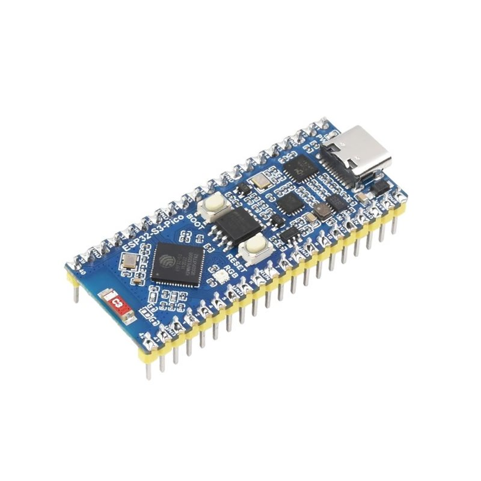
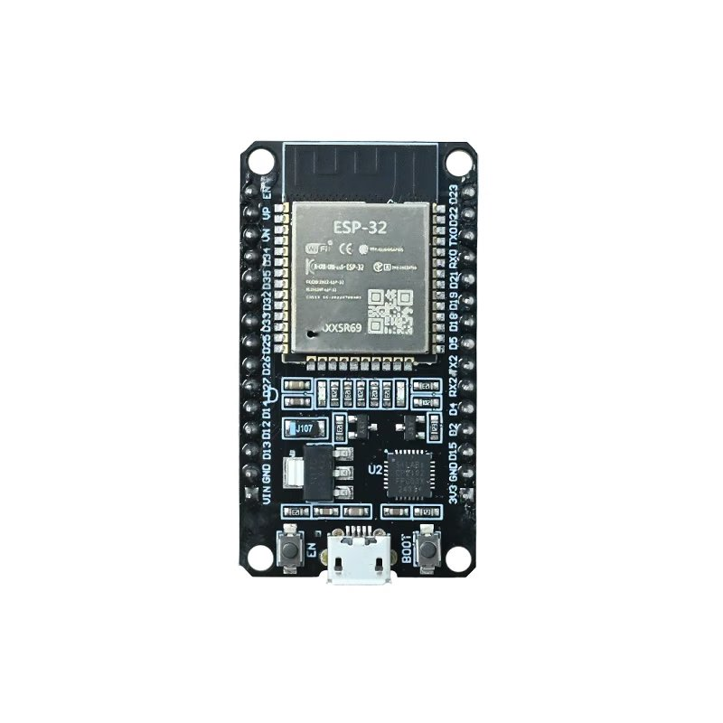

# Waveshare ESP32-S3-Pico Microcontroller Development Board with Pin Header (SKU: 1552780)

## 1. Technical Specifications

| Parameter | Specification |
| :--- | :--- |
| **Product Name** | Waveshare ESP32-S3-Pico Microcontroller Development Board (with Pre-Soldered Pin Header) |
| **Vendor & SKU** | Robu.in — **SKU: 1552780** (Ordered) |
| **Item Type** | ESP32 Based, S3 Variant (`ESP32-S3R2` SoC) |
| **Processor** | Xtensa® 32-bit LX7 Dual-Core Processor @ up to **240 MHz** |
| **Flash Memory** | **16 MB** (`W25Q128JVSIQ` Quad-SPI Flash) |
| **PSRAM** | **2 MB** (Integrated Quad-SPI PSRAM) |
| **SRAM / ROM** | **512 KB** SRAM / **384 KB** ROM |
| **Wireless Connectivity** | 2.4 GHz Wi-Fi (802.11 b/g/n) + **ESP-NOW** + Bluetooth 5 (LE) |
| **Onboard USB & UART Chips** | **CH343P** (USB-to-UART) + **CH334F** (USB Hub Controller) — supports simultaneous Native USB & UART flashing via a **single USB Type-C port** |
| **Power Regulator** | Onboard **MP28164** high-efficiency DC-DC buck-boost converter (`3.7V–5.5V` input on `VSYS` / `VBUS`, up to `2A` output current) |
| **Peripheral Interfaces** | Multi-Lane I2S (2× I2S controllers), USB OTG, SPI, I2C, UART, ADC, PWM, DVP (8–16 bit camera), LCD interfaces, 27× Multi-function GPIOs |
| **Header Configuration** | **Pre-Soldered 40-Pin Yellow Male Headers** (Zero soldering required on the ESP32-S3 board!) |
| **Shipping Dimensions / Weight** | 7 × 5 × 3 cm / 0.012 kg |

---

## 2. Silkscreen Pin Mapping for Copper Chimney V2 (6-Ch I2S Audio DSP Engine)

All required pins are clearly printed on the top blue PCB silkscreen next to the pre-soldered yellow header pins:

| Silkscreen Label on `ESP32-S3-Pico` | Function in Copper Chimney V2 | Connects To | Wire Color / Notes |
| :---: | :--- | :--- | :--- |
| **`VBUS` or `VSYS`** | `+5.0V` DC Power Input | **XL4015 Buck `OUT+` (`5.00V`)** | Orange (`24 AWG`) |
| **`3V3`** | `+3.3V` Logic Output | **PCM1808 ADC `3.3V` Pin** | Yellow (`24 AWG`, clean 3.3V from onboard MP28164) |
| **`GND`** *(multiple pins)* | Common Digital/Logic Ground | **XL4015 Buck `OUT-` + 3× DAC `GND` + ADC `GND`** | Black (`24 AWG`) |
| **`15`** (`GPIO 15`) | **`I2S_BCK`** (Shared Bit Clock) | **2× PCM5102A (`BCK`) + PCM1808 (`BCK`) + Slave ESP32 (`GPIO 26`, input)** | Cyan (`28 AWG` Female DuPont) |
| **`16`** (`GPIO 16`) | **`I2S_LRCK`** (Shared Word Select) | **2× PCM5102A (`LCK`) + PCM1808 (`LRC`) + Slave ESP32 (`GPIO 25`, input)** | Blue (`28 AWG` Female DuPont) |
| **`7`** (`GPIO 7`) | **`I2S_DOUT1`** (DAC #1 Data) | **PCM5102A DAC #1 (`DIN`)** → Amp #1 (`FL 30W / FR 30W`) | Purple (`28 AWG` Female DuPont) |
| **`6`** (`GPIO 6`) | **`I2S_DOUT2`** (DAC #3 Data) | **PCM5102A DAC #3 (`DIN`)** → Amp #3 (`Center + Sub`) | Purple (`28 AWG` Female DuPont) |
| **`5`** (`GPIO 5`) | *Unused (reserved)* | DAC #2 (Surround, Amp #2) is driven by the Slave ESP32-WROOM-32 (see section 3) | — |
| **`4`** (`GPIO 4`) | **`I2S_DIN`** (ADC Audio In) | **PCM1808 ADC (`OUT`)** ← 3.5mm Stereo AUX Jack | Green (`28 AWG` Female DuPont) |
| **`2`** (`GPIO 2`; keep `GPIO 0` free - strapping pin) | **`I2S_MCLK`** (256×fs Master Clock) | **PCM1808 ADC (`SCK`)** | Yellow (`28 AWG` Female DuPont) |
| **2.4 GHz Antenna (`C3`)** | **Wireless ESP-NOW / Wi-Fi Link** | **Waveshare 4.3B Touch Screen (`Model 28141`)** | Wireless `<2ms` Battery Sofa Remote (or wired `I2C` on pins **`8`** & **`9`**) |

---

## 3. Slave Audio MCU - ESP32-WROOM-32 30-Pin (Surround L/R, PCM5102A #2 → Amp #2)

**Why a second MCU:** each ESP32-S3 I2S controller has one data-out line, so the Pico can feed only 2 PCM5102A DACs. The Slave feeds the 3rd, giving 6 independent channels (separate EQ / delay / volume per channel).

**Proposed pin map (silkscreen labels on the board; verify against the photo before soldering):**

| Slave pin (silkscreen) | Function | Connects To | Notes |
| :---: | :--- | :--- | :--- |
| **`D26`** | `I2S_BCK` (input, slave) | Pico `GPIO 15` (same net as DACs / ADC) | Short wire |
| **`D25`** | `I2S_LRCK` (input, slave) | Pico `GPIO 16` | Short wire |
| **`D35`** | `I2S_DIN` (input only) | PCM1808 `OUT` (parallel with Pico `GPIO 4`) | `D35` is input-only, fine for DIN |
| **`D27`** | `I2S_DOUT` | PCM5102A #2 `DIN` | Output-capable pin |
| **`VIN`** | `+5 V` | Clean `5 V` rail (XL4015) | Do not connect USB and `VIN` at the same time |
| **`GND`** | Ground | Common ground | Must share ground with Pico, DACs, ADC |

Avoid on this board: `D0/D2/D5/D12/D15` (strapping), `D34-D39` as outputs (input-only), flash pins `6-11`. `GPIO 0` is not broken out on this 30-pin board (only the BOOT button); a slave does not need it.

**Control:** the Slave receives the same UI commands as the Pico over ESP-NOW. Master volume and mute must reach both boards together; if the surrounds ever jump relative to the mains, switch to a wired UART link from the Pico to the Slave.

**To verify in firmware:** (a) the Pico's second I2S controller (`DOUT2`) must use the same BCK/LRCK as I2S0 so all three DACs stay sample-locked; (b) the Slave's I2S pipeline adds a small fixed offset, absorbed in the Surround delay setting.
